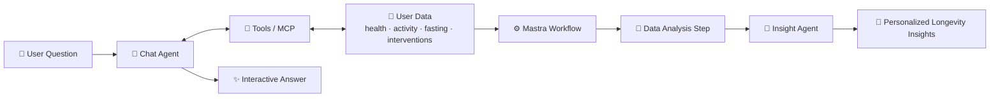

 

---

## 👋 About Me

I'm a **Backend Developer & AI Agent Builder** based in **Semarang 🇮🇩**, a.k.a. *napkincode*. I design intelligent systems that make human–AI collaboration feel natural and useful, with a current focus on **agent orchestration, workflows, and interactive AI experiences** for health and longevity.

- 🔭 Building **LongeAge**, an AI-powered longevity platform
- 🤖 Designing multi-agent workflows with **Mastra** and TypeScript
- 💬 Making AI more **interactive**, **context-aware**, and **personal**
- 🌱 Exploring MCP, tool-calling, agent memory, and evals

---

## 🚀 Featured Project: LongeAge

> An **AI-driven longevity coach** that turns your daily data into adaptive, personalized guidance.

| 📊 Track | 🧠 Understand | 💬 Interact |
|---|---|---|
| Health metrics, steps & workouts | Workflows that analyze user data | AI agent that answers longevity questions |
| Fasting windows | Longevity insights & trends | Answers grounded in *your* own data |
| Cold plunge, sauna & other interventions | Pattern detection across habits | Social feed to stay motivated together |

### 🏗️ How the AI Works

**Under the hood:** TypeScript · Mastra (agents, workflows, tools) · AI SDK · OpenAI · MCP · PostgreSQL

👉 **[Explore LongeAge Mentor](https://github.com/semarangplaza/)**

---

## 🛠️ Tech Stack

---

## 📊 GitHub Stats

---

> *"Code with clarity, design with intent, and let AI handle the rest."*

