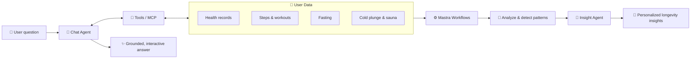

 

---

## 👋 About Me

I'm **Rahadian**, a.k.a. *napkincode*, an **AI engineer and backend developer** from **Semarang 🇮🇩**. I build the intelligence layer behind products: agent orchestration, data-driven workflows, and conversational experiences that feel natural instead of robotic.

- 🔭 Currently building **LongeAge**, a longevity platform with an AI coach at its core
- 🤖 Designing agents and workflows with **Mastra** and TypeScript
- 💬 Obsessed with making AI **more interactive, context-aware, and personal**
- 🌱 Exploring tool-calling, MCP, agent memory, streaming UX, and evals

---

## 🚀 Currently Building: LongeAge

> A longevity platform that turns everyday health data into adaptive, personalized guidance.

**What users can do in the app**

| 🩺 Health & Activity | 🧊 Interventions & Fasting | 🌐 Community |
|---|---|---|
| Health records & metrics | Cold plunge sessions | Social feed for longevity enthusiasts |
| Steps & workouts | Sauna sessions | Share progress & stay accountable |
| Daily activity trends | Fasting windows | Learn from others' routines |

**What the AI does (my part of the stack)**

- 🧠 **Insight workflows**: scheduled and event-driven Mastra workflows read a user's health, activity, fasting, and intervention data, then produce longevity insights and trends
- 💬 **Longevity Q&A agent**: users ask questions about longevity *and about their own data*, and the agent answers grounded in what they've actually logged
- 🔧 **Tool-calling**: the agent fetches real user data through typed tools instead of guessing

### 🏗️ Architecture at a Glance

### ✨ Making the AI More Interactive

What I'm working on to make the coach feel less like a chatbot and more like a mentor:

- ⚡ Streaming responses for a faster, more natural conversation
- 🧩 Richer answers that can surface the user's own metrics inside the chat
- 💡 Context-aware follow-up suggestions based on recent activity
- 🧠 Agent memory so the coach remembers goals and preferences
- 🤝 Human-in-the-loop steps in workflows for confirmations before taking action
- 📈 Evals to keep answers accurate, safe, and genuinely helpful

**Tech:** TypeScript · Mastra (agents, workflows, tools) · AI SDK · OpenAI · MCP · PostgreSQL

👉 **[LongeAge on GitHub](https://github.com/semarangplaza/)**

---

## 🛠️ Tech Stack

---

## 📈 Activity

---

> *"Code with clarity, design with intent, and let AI handle the rest."*

